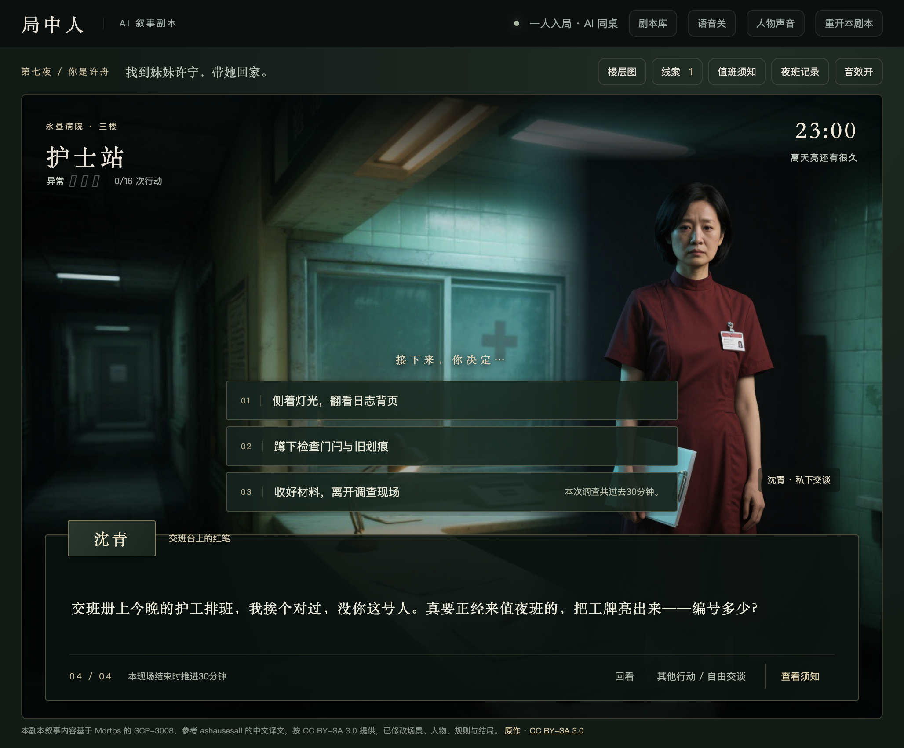

# 《夜班病院》橙光式界面独立试玩评测

日期：2026-11-19。试玩入口：`http://127.0.0.1:8003/?script=night_ward`。评测者为独立浏览器评测 agent；主 agent 整理报告并核对公开存档与截图。

## 结论

**独立评测员认为，本次护士站片段满足他的橙光式体验预期，并愿意继续玩。** 主观评分为好玩 **7/10**、沉浸 **8/10**、阅读 **8/10**。本轮完整体验了一个调查现场中的阅读、物件选择、材料取得与自由追问；没有通关，不能据此判定整个副本持续好玩或达到成熟橙光作品的完成度。

| 维度 | 评测员感受 | 证据与限制 |
| --- | --- | --- |
| 好玩：7/10 | 调查有后果，人物有条件地合作；愿意继续追问她的动机。等待打断节奏。 | 翻护理日志取得实际线索，沈青自主交付工牌；仅覆盖这一条调查路径，未验证其他选择与后续承诺。 |
| 沉浸：8/10 | 病院背景、沈青立绘、时钟与随身笔记形成氛围；对白有谨慎、怕担责与补偿的矛盾。 | 有实际页面截图及真实NPC对白；未验音效、妹妹救助、巡查或结局。 |
| 阅读：8/10 | 一段一段读，旁白、玩家和沈青的说话者区分清楚，读完再出现选择。 | 现场从04/04继续至09/09；这是调查现场的对白进度，不能当作完整入场序章已测。 |

评分来自一位AI评测员的有限试玩，不是玩家调研统计，也不是与橙光作品的量化对标。

## 实际游玩与证据

结束时公开状态为 **v105、护士站、23:00、行动0/16、异常0**。“交班台上的红笔”调查尚未结束，`paid=false`；没有待生成人物，仍可继续调查或结束现场。

1. 阅读护士站现场及沈青对白。现场记录中沈青质问：“你就是借招聘混进来的许舟？……你来三楼，是找你妹妹，还是先找我麻烦？”随后有玩家“你凭什么说我是混进来的？”及沈青核对排班、追问工牌编号的对话。本轮评测员读到了这些内容；没有足够记录确认它们全部由评测员当轮输入。
2. 实际选择“侧着灯光，翻看日志背页”。程序记录：“你把纸页对着台灯，压痕露出沈青的签名。她的手停在半空，没有再替你翻页。”手中实际新增“留有压痕的护理日志”，沈青回应并交付“编号0719的备用通行工牌”。
3. 从“其他行动 / 自由交谈”向沈青发问：“沈青，你到底为什么要给我这个工牌？你说你没害过人，但你删改记录的真正目的是什么？”
4. 收到真实回应：“工牌给你，一半是堵你的嘴。你拿着那本日志，我怕你天亮出去把我改记录的事抖出去。另一半是真的——那批病人三天前没走成，我是当班的，不敢写‘仍在院’，怕担责，就全改成了‘已出院’。是我胆小，不是我害的人。你妹妹的事，我陪你查到底，算我还一笔。”
5. 打开随身线索，看到招聘登记、护理日志和备用工牌，以及单列的已公开值班须知。最后读到09/09，调查仍可继续。

上述新增调查、交付及私聊均得到本轮公开状态与现场日志核对支持。人物口头承诺“陪你查到底”没有在后续行动中验证，不能当作实际同行已经实现。

评测截图为调查前段04/04、尚未翻日志的选择画面；不是v105的终点截图。

## 反馈给开发者的重点

| 优先级 | 反馈 | 下一步验收标准 |
| --- | --- | --- |
| P1 | **等待削弱行动节奏。** 评测员在调查接话和自由提问时明显感到长等；现有“正在斟酌”“请求并未取消”说明存在，但仍让他感到不确定。 | 用实际计时分别记录提交、现场结果返回、人物回复返回；让玩家清楚知道正在等哪一步，能直接回看与读材料。没有服务端进度时，不显示虚构百分比或预计完成时间。 |
| P2 | **对白读完与下一选择的关系仍可更明确。** 评测员把末段不可再点击理解成“继续入口失效”，也把结束选项的30分钟说明理解为已经扣时。 | 首次遇到末段时明确提示从上方选项继续；清楚说明“结束此现场时推进30分钟”。保持阅读免费、现场统一计时。 |
| P2 | **等待时阅读入口可更显眼。** 自由交谈窗口禁用输入使评测员产生被锁住的感受。 | 保持写入防重，同时让收起输入、回看和已取得材料容易发现；必须在真实等待中确认可用，不凭代码判断手感。 |

本轮只交付评测与开发反馈，没有修改游戏代码、模型或规则，也没有承诺将回复速度降到15秒。

## 原评测问题清单的核对

保留评测员“满足预期”的主观判断，但以下原始问题不能直接当作已证实的软件缺陷：

- **“23:00没有实时更新”**：当前调查未结束，读对白与同场交谈不扣时，末尾的30分钟是结束选项的代价。不是已证实的计时故障；可作为说明易误读的体验反馈。
- **“段末按钮disabled”**：末段读完后显示中央选项，原本不应继续生成下一段。可讨论提示是否足够明确，不能直接要求自动选择或跳过决定。
- **“没有等待反馈”**：评测员本人已观察到斟酌提示与超过10秒说明。确认的是反馈仍不足以缓解漫长等待的感受，不是完全没有提示。
- **“场景切换后UI残留”**：原报告同时明确未测试离开调查现场。现有截图中选项在对白上方，符合视觉小说布局；没有实际跨场景残留的证据，列为未确认。
- **“线索提示与对白重叠”**：提供的截图没有新线索提示，未提供重叠时的画面或坐标。列为未确认，需要真实取得材料时复验。
- **“等待时没有回看等替代操作”**：本轮没有操作记录证明尝试收起窗口、回看或打开材料失败。保留入口不明显的感受，不认定这些功能不存在。
- **“查看须知文案不一致”**：原报告列出的两个文案相同，未能构成不一致证据。
- **“单人局公开材料无意义”**：这个副本中公开会改变NPC的可见材料范围，包括广播声音；本轮没有测试它，不能因单人玩法判断没有作用。

原报告对等待同时使用“10–75秒”“调查约2分钟”“私聊约45秒”等表述，没有逐条计时记录。报告只采用长等待的体验结论，不把这些估计用作接口性能数据。原报告提到每段30–60字，当前实现允许按句拆分至145字以内；实际长段阅读尚需专门抽验。

## 未覆盖

没有确认评测员亲自重开或读完完整入场序章；未离开当前调查现场，未测楼层图、夜班记录、公开材料、另一调查选择、跨房间连续性、妹妹救助、危险代价、音效、失败恢复或任何结局。上述限制不改变这一护士站片段的正面评价，也不应由前轮开发者的技术检查代替。

## 开发 agent 接收回执

开发 agent 已阅读本报告及三份相关前端源码，接收上述三个重点，交回以下最小改善位置；没有实现改动或进行新的UI验收：

- **等待提示**：现有真实阶段和10秒说明已经存在，但自由交谈窗口内应同时展示它们，并立即说明可以收起输入继续阅读；不得根据计时猜测动作已保存。
- **末段指引**：当前对白末段禁用后，底部变成计时说明或“阅读对白不耗时”，右侧是“查看须知”，容易缺少继续方向。仅在中央选项确实可见时提示“本段已读完，请从上方选项继续”，另列结束代价；等待、输入展开或回复未完成时不能误指不存在的选项。
- **阅读入口**：源码中的回看、须知、收起输入和历史谈话没有被统一禁用。可在输入窗口突出“收起输入并回看”；完整材料应复用现有只读面板，不能将阅读与私下出示混为一项操作。

开发者确认这些是提示与发现性的改善建议，不是计时或写入锁故障。复验应在调查及自由提问的真实等待中实际回看、读材料并尝试重复提交，核对阅读可用、防重仍有效；本轮没有把源码核对算作该项复验通过。
